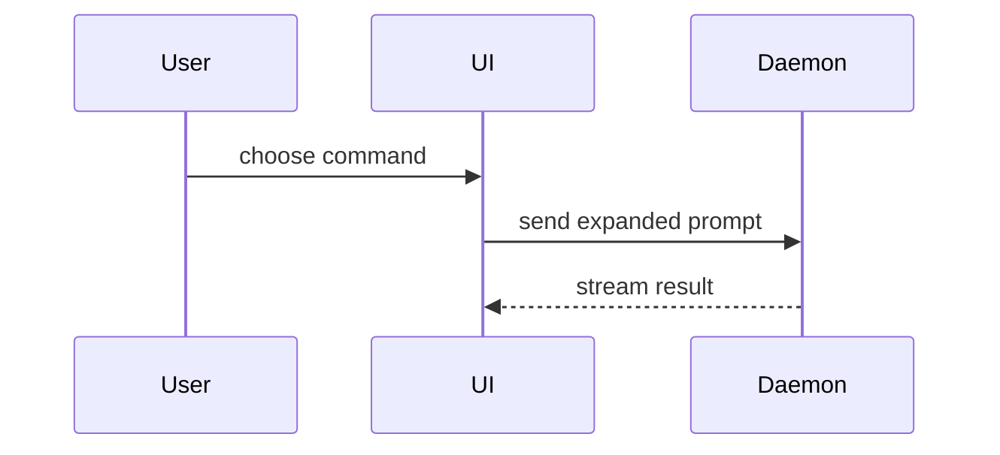

用这个模板写 PR 正文：

```markdown
## Summary

<diagram, diff-sketch, or tree>

## Evidence

- **Before:** <screenshot/output/failing test run>
  **After:** <screenshot/output/passing test run>

## Merge Danger

**Door:** <one-way or two-way>

<optional: description>

**Blast Radius:** <one-word description>

<optional: potential ramifications of merge>
```

## 各节

所有前言都省掉，正文尽量简短。使用 `GLOSSARY.md` 里用户的领域语言。

### 摘要

挑一个最小的视图，把要点说清楚。

- 逻辑或算法用伪代码表示：

```text
on(save)
  if content is unchanged
    return cached result
  write new content
  return fresh result
```

- 运行时的控制流用调用树表示：

```text
submitForm
  createSession
    persistPrompt
    launchAgent
  navigateToSession
```

- 界面结构用组件树表示，包含要紧的状态和模块边界：

```text
<SessionPage> (apps/example/src/routes/session.tsx)
  useSessionEvents()
  <SessionToolbar>
    <RunSkillButton> (packages/ui)
```

- 文件职责或大范围重构用浅层文件树表示：

```text
src/
├── commands/       # parses user actions
├── sessions/       # owns session state
└── transport/      # sends API requests
```

- 组件交互、控制流或数据流用 Mermaid 表示：



- 当要点是“改了什么”、而且周围的形态已经存在时，用 `diff`。让 diff 的形态与主题相配。

组件变化：

```diff
 <SessionPage>
   useSessionEvents()
   <SessionToolbar>
+    <RunSkillButton />
   <SessionTimeline>
+    <SkillResultCard />
```

文件布局变化：

```diff
 src/
 ├── commands/
+│   └── show-me.ts       # expands the slash command
 ├── sessions/
-└── transport.ts
+└── transport/
+    ├── client.ts
+    └── stream.ts
```

调用树或调用栈变化：

```diff
 submitForm
   createSession
     persistPrompt
+    expandSkillMention
     launchAgent
-  navigateToSession
+  navigateToSession
+    subscribeToEvents
```

状态或控制流变化：

```diff
 on(save)
-  write content
+  if content is unchanged
+    return cached result
+  write new content
+  invalidate cache
```

- 当大部分内容都是新的、省略上下文会掩盖归属或顺序，或者用户需要一段可以复制的目标形态时，就整块展示：

```ts
function expandSkill(command: string): string {
  const skillName = command.slice(1);
  return `use the ${skillName} skill`;
}
```

#### 指引

每个图表都放在它所支撑的那几行文字旁边。只保留回答问题或给出解决当前讨论点所需选项时用到的调用、文件、props、状态和边界。

下面这些你可以用一种，也可以用几种，但不太可能全用上。自己判断，不要把用户淹了。

### 证据

能证明改动有效的具体证据。给出改之前和改之后。

截图是 S 级证据，前提是环境允许、而且改动是视觉上的。

基于执行的证据是 A 级证据：测试结果、控制台输出。用伪代码给出那个从失败变为通过的具体测试。

### 合并风险

说明这扇门是单向的还是双向的。双向门可以走回来，单向门不行。回滚成本低的 PR 风险更低。涉及破坏性操作或难以撤销的决定的改动属于单向门。

影响面是这次 PR 引入的改动可能造成的冲击或波及范围。把各种可能都考虑进去。例子包括布局错位、影响调用方的破坏性变化、移动端响应式表现等等。
